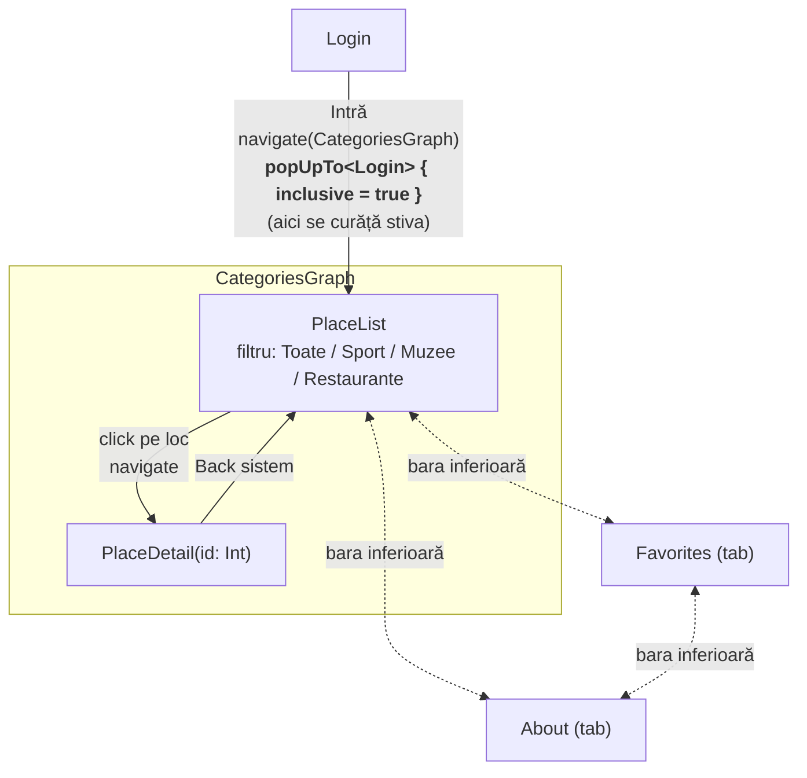

# Ghid Maramureș – obiective turistice

Temă Calcul Mobil, Laboratorul 05: aplicație Android (Kotlin + Jetpack Compose) de tip ghid turistic,
cu accent pe navigare: **Navigation Compose (Nav2) cu rute type-safe**, argumente, back stack și
ecrane decuplate de `NavController` (state hoisting). UI: Material 3.

## Rulare

1. Deschideți proiectul în Android Studio și așteptați sincronizarea Gradle.
2. Porniți un emulator sau conectați un telefon (minSdk 24).
3. Run ▶ pe configurația `app`, sau din linia de comandă:

   ```bash
   ./gradlew :app:installDebug
   ```

La Login se acceptă orice utilizator și parolă nevide.

## Structura

| Fișier | Rol |
|---|---|
| `data/PlacesRepository.kt` | Singura sursă de date: 10 obiective (Sport, Muzee, Restaurante) |
| `navigation/Routes.kt` | Rutele `@Serializable` (`Login`, `CategoriesGraph`, `PlaceList`, `PlaceDetail(id)`, `Favorites`, `About`) |
| `navigation/GuideApp.kt` | `Scaffold` + `NavHost` + bara inferioară – singurele locuri unde apare `NavController` |
| `GuideViewModel.kt` | Filtrul curent și favoritele, în `SavedStateHandle` (rezistă la navigare, tab-uri, rotire) |
| `ui/screens/*.kt` | Ecranele; primesc date și lambda-uri (`onNavigateToDetail: (Int) -> Unit`, `onBack: () -> Unit`), nu `NavController` |

## Fluxul de navigare



Detalii:

- **Argument:** `PlaceDetail(val id: Int)` se citește în destinație cu `entry.toRoute<PlaceDetail>()`;
  restul datelor vin din `PlacesRepository.getPlace(id)`.
- **Curățarea stivei la autentificare:** `popUpTo<Login> { inclusive = true }` scoate Login din stivă,
  deci Back de pe listă închide aplicația.
- **Bara inferioară:** fiecare tab navighează cu
  `popUpTo<PlaceList> { saveState = true }`, `launchSingleTop = true`, `restoreState = true`.
  Astfel un detaliu deschis în Categorii este tot acolo după o vizită în Favorite, iar o apăsare
  repetată pe tab-ul curent nu adaugă o copie. (`PlaceList` este startul grafului rămas după
  eliminarea Login-ului, echivalentul lui `graph.findStartDestination()`.)
- **Tab marcat:** se verifică `destination.hierarchy`, așa că în `PlaceDetail` rămâne marcat
  tab-ul Categorii (părintele `CategoriesGraph`).
- **Back consistent:** din detaliu atât Back-ul sistemului, cât și săgeata din TopAppBar fac
  `popBackStack()` și revin la listă, cu filtrul păstrat.
- **Stiva tipică:** `[CategoriesGraph › PlaceList › PlaceDetail]`; din Favorite/Despre, Back revine
  la Categorii, iar de pe listă închide aplicația.

